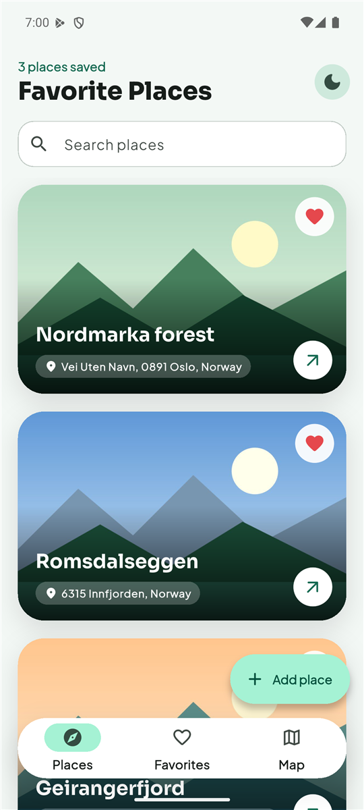
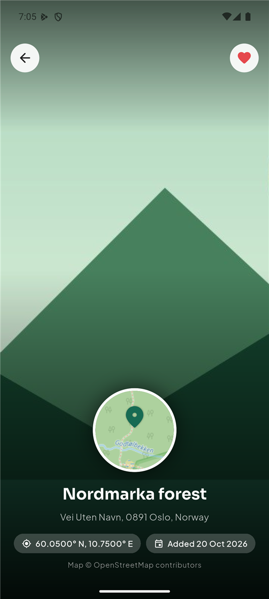
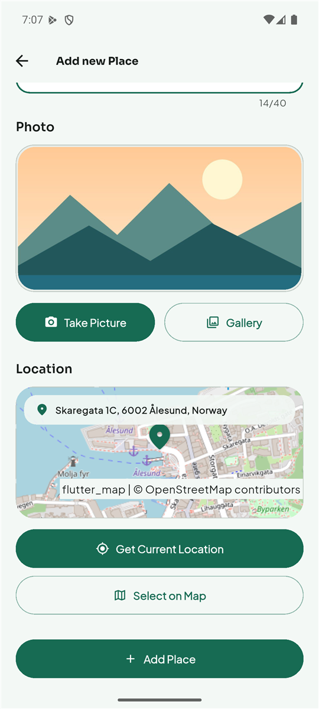
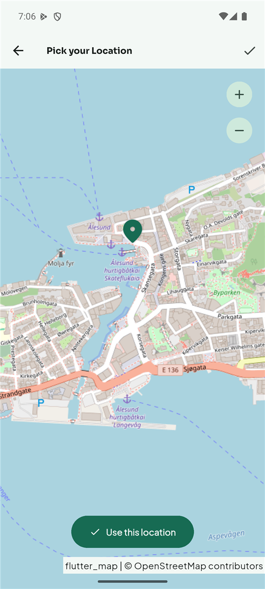
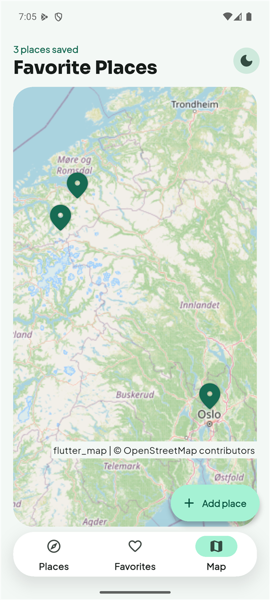
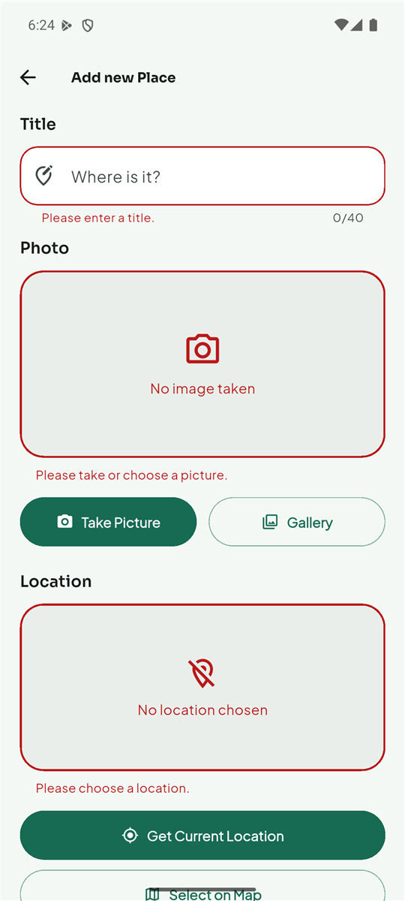
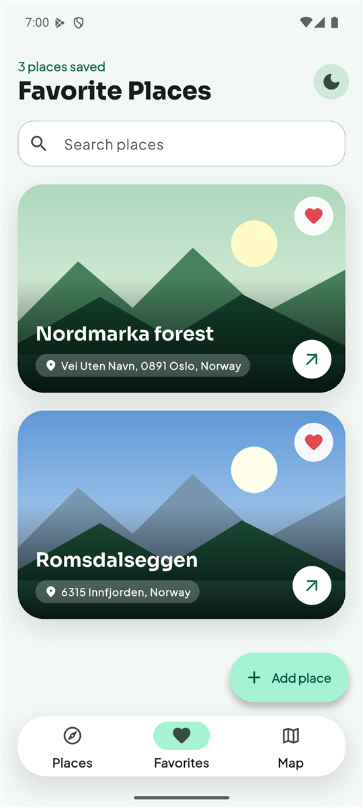
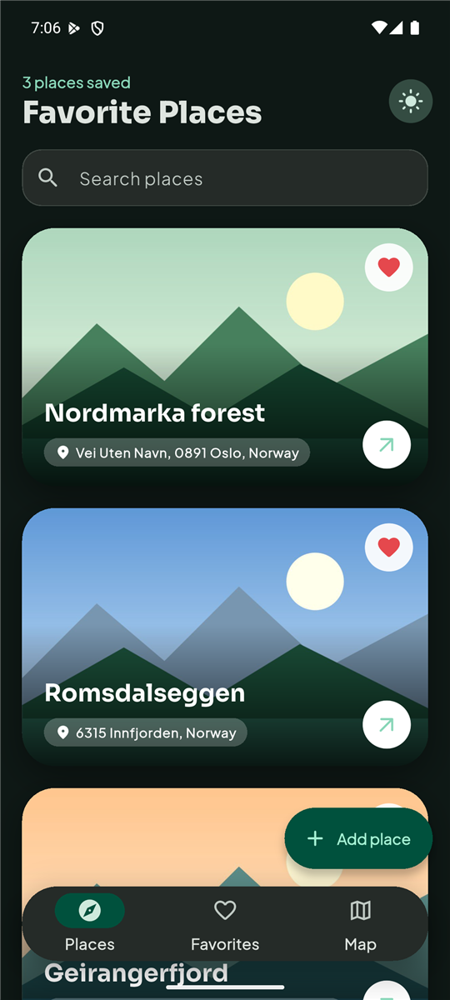

# Favorite Places

A Flutter app for saving the places you love: take a photo, record where you are (or pick the
spot on a map), and keep everything on the phone. Built for the NTNU *Mobile Applications*
course (Assignment #5, "Using native device features").

<p align="center">
  
  
  
</p>

<p align="center">
  
  
  
</p>

<p align="center">
  
  
</p>

## Features

| Assignment requirement | How it is done |
| --- | --- |
| 1. List of saved places with name and photo | `PlacesListScreen` + `PlacesList` + `PlaceCard` |
| 2. Form to add a place | `AddPlaceScreen` (title, photo, location) |
| 3. Take a photo with the camera | `ImageInput` + `PhotoService` (package `image_picker`) |
| 4. Record the location: current position or pick on the map | `LocationInput` + `LocationService` (package `location`) and `MapScreen` (`flutter_map`) |
| 5. Place details: name, photo, location | `PlaceDetailScreen` |
| 6. Show the place on a map | round map preview on the details screen, full `MapScreen` on tap, `PlacesOverviewMap` for all places |
| 7. Keep title, photo reference and coordinates after a restart | `SqlitePlacesRepository` (sqflite); the photo is copied to the app folder and only its path is stored |
| 8. Navigation list / form / details | `Navigator.push` / `pop` with a fade-and-slide transition, `Hero` photo |
| 9. Validate the input and show messages | `Form` + `GlobalKey`, one validator per field |

Extras: a **Favorites** tab with a heart on every place, **search** by title or address,
**swipe right to delete** with Undo, a map with **all places**, **light / dark** theme (saved),
animations, Google Fonts.

## Maps and the API key (important)

**The map needs no key.** All maps are [OpenStreetMap](https://www.openstreetmap.org) tiles shown
with the `flutter_map` package. No account, no billing, nothing to remove before submitting. (They
use the public OSM tile server, which is fine for a course project but not meant for a production
app, see the [tile usage policy](https://operations.osmfoundation.org/policies/tiles).)

**The address uses one Google key.** Turning coordinates into a street address is done with the
Google *Geocoding API v4*. It also works with the free **Maps Demo Key** (no billing account).
Give the app the key in one of two ways:

```bash
flutter run --dart-define=GOOGLE_MAPS_API_KEY=your_key
```

or paste it into `_yourKey` in `lib/config/api_keys.dart`.

**The key is never committed.** The assignment asks to remove private keys before submitting, so the
delivered project has the placeholder `YOUR_GOOGLE_MAPS_API_KEY`. (With `--dart-define` there is
nothing in the code to remove.) Without a key the app still works: a place simply gets its
coordinates as its address, for example `62.4722° N, 6.1549° E`.

> iOS: the permission texts are in `Info.plist`, but iOS was not tested. The app was developed and
> tested on the Android emulator.

## Architecture

The same three layers as in the lectures.

- **Data layer** (`lib/data`): everything that talks to the outside world: the database, the
  photo files, the camera/gallery, the GPS and the Google Geocoding service. Each one is a small
  class behind an interface, so tests can replace it.
- **Model layer** (`lib/models`, `lib/providers`): `Place` / `PlaceLocation` and the Riverpod
  providers that hold the state and the business logic.
- **UI layer** (`lib/screens`, `lib/widgets`, `lib/theme`): screens and widgets that watch the
  providers and react to user input, including validation.

```
lib/
├── main.dart                         Entry point: ProviderScope + MaterialApp (theme, mode)
├── config/
│   └── api_keys.dart                 Placeholder for the Google key (addresses only)
├── models/
│   └── place.dart                    Place (id, title, image, location, isFavorite) + PlaceLocation
├── data/
│   ├── places_repository.dart        Interface: fetch / insert / setFavorite / delete
│   ├── sqlite_places_repository.dart The real database (sqflite)
│   ├── image_store.dart              Copies photos to the app folder (path_provider + path)
│   ├── photo_service.dart            Camera / gallery (image_picker)
│   ├── location_service.dart         GPS: service on? permission? position (location)
│   └── geocoding_service.dart        Coordinates to address, Google Geocoding v4 (http)
├── providers/
│   ├── user_places.dart              UserPlacesNotifier: load, add, favorite, remove, restore
│   ├── ui_state.dart                 Search text, filtered lists, theme mode
│   └── services.dart                 Providers of the services and the tile provider (replaceable in tests)
├── screens/
│   ├── places_list_screen.dart       Home: header, search, 3 tabs, FutureBuilder, add button
│   ├── add_place.dart                Form with validation
│   ├── place_detail.dart             Full-screen photo, round map, address
│   └── map.dart                      Interactive map: pick a point or view a place
├── widgets/
│   ├── image_input.dart              Photo preview + Take Picture / Gallery
│   ├── location_input.dart           Location preview + Get Current Location / Select on Map
│   ├── places_list.dart              List with swipe-to-delete and Undo
│   ├── place_card.dart               Photo card, heart button, photo widget
│   ├── places_overview_map.dart      One map with a pin for every place
│   ├── map_preview.dart              Small map that cannot be moved (or a drawn placeholder)
│   ├── map_layers.dart               OSM tile layer, credit text, pin marker
│   └── state_views.dart              Empty and error messages
├── theme/app_theme.dart              Material 3 theme from one green seed color
└── utils/transitions.dart            Fade-and-slide page route
test/                                 Unit and widget tests (fakes in test/helpers)
docs/screenshots/                     Screenshots used in this README
```

## How it works

**State: Riverpod.** `ProviderScope` (in `main.dart`) holds all providers. `userPlacesProvider` is a
`NotifierProvider<UserPlacesNotifier, List<Place>>`: its state is the list of places, and every
widget that does `ref.watch(userPlacesProvider)` rebuilds when it changes. Widgets call methods
with `ref.read(userPlacesProvider.notifier)`. `visiblePlacesProvider` and `favoritePlacesProvider`
are derived providers (search and favorites are calculated, not stored twice).

**Loading.** `PlacesListScreen` creates the `Future` that reads the database once in `initState`
and shows it with a `FutureBuilder` (spinner while loading, a message with "Try again" on error).

**Camera and gallery.** `ImagePickerPhotoService` calls `ImagePicker().pickImage(...)`, which opens
the system camera or photo picker. No camera permission is needed because the system app takes the
picture. The picture is resized (`maxWidth`, `imageQuality`) to keep files small.

**Location.** `DeviceLocationService` follows the three steps of the `location` package: is the
location service on, does the app have permission (the system asks the user at that moment), then
read the position. A refusal becomes a readable message under the preview, never a crash. The
permissions are declared in `AndroidManifest.xml`. The Geocoding API (v4, reverse geocoding by
location) turns the coordinates into an address; if that fails the coordinates are used, so a
place can always be saved.

**Maps.** A map is a grid of small pictures (*tiles*) that are downloaded for the visible area.
`FlutterMap` shows them (`TileLayer`), draws pins on top (`MarkerLayer`) and reports taps
(`MapOptions.onTap` gives the tapped latitude and longitude). The small previews are the same
widget with every gesture switched off, on top of a drawn placeholder so that they still look like
a map offline.

**Storage.** The camera saves into a temporary folder, so `LocalImageStore` copies the photo into
the app's documents folder. The database (`favoriteplaces.db`, table `user_places`) stores the
title, the photo *path*, latitude, longitude, address, favorite flag and creation time. Because
screens only know `PlacesRepository`, the storage could be swapped (for example for Firebase) without
touching the UI.

**Forms.** `AddPlaceScreen` uses a `Form` with a `GlobalKey<FormState>`. `validate()` checks every
field and shows the messages, `save()` copies the values into variables. Each field validates
itself once the user has touched it (a Form-level mode would flag untouched fields too). The
photo and the location are `FormField`s, so their messages look and work like the title's.

**Delete with Undo.** A swipe removes the place from the list and the database at once but keeps
the photo file. Only when the Undo bar disappears unused is the file deleted.

## Tests

```bash
flutter test
flutter analyze
```

The tests cover the Google Geocoding service (with a fake `http` client), the real SQL against a
real SQLite file (the desktop `sqflite_common_ffi` version), the providers (load, add, rollback,
favorites, remove and restore, search) and every screen (empty state, error and retry, search,
favorites, swipe and Undo, every validation message, camera, gallery, a denied location, picking a
point on the map, a full save, a failed save, the details and map screens). Services and the map
tiles are replaced by fakes through Riverpod overrides, so no test needs a network.

## Run the app

Requirements: Flutter SDK (Dart 3.13+) and an Android emulator or phone with internet (for the map
tiles and the addresses).

```bash
flutter pub get
flutter run
```

Tips for the emulator: set a position with *Extended controls > Location* (or
`adb emu geo fix <longitude> <latitude>`), and the camera shows a virtual room you can photograph.

**Windows note.** If the Android build fails in `compileDebugKotlin` with "this and base files
have different roots", the project and the Pub cache are on different drives.
`android/gradle.properties` already sets `kotlin.incremental=false` to avoid this.

## Dependencies

| Package | What it does here |
| --- | --- |
| [`flutter_riverpod`](https://pub.dev/packages/flutter_riverpod) | State management: providers and notifiers |
| [`image_picker`](https://pub.dev/packages/image_picker) | Camera and gallery |
| [`location`](https://pub.dev/packages/location) | The phone's current position and the permission dialog |
| [`flutter_map`](https://pub.dev/packages/flutter_map) | The interactive map (OpenStreetMap tiles, pins, taps) |
| [`latlong2`](https://pub.dev/packages/latlong2) | The `LatLng` type (latitude and longitude) used by the map |
| [`http`](https://pub.dev/packages/http) | The Geocoding (v4) request |
| [`sqflite`](https://pub.dev/packages/sqflite) | The SQLite database on the phone |
| [`path_provider`](https://pub.dev/packages/path_provider) | Where the app may keep its files |
| [`path`](https://pub.dev/packages/path) | Building file paths that work on every platform |
| [`uuid`](https://pub.dev/packages/uuid) | Unique ids for places |
| [`shared_preferences`](https://pub.dev/packages/shared_preferences) | Remembers the light / dark choice |
| [`google_fonts`](https://pub.dev/packages/google_fonts) | Sora and Plus Jakarta Sans without bundling font files. Pinned to 6.3.3 because 9.x needs the newer `material_ui` package, which doesn't match this Flutter SDK |
| [`flutter_animate`](https://pub.dev/packages/flutter_animate) | Short declarative animations (fade, slide, scale) |
| [`sqflite_common_ffi`](https://pub.dev/packages/sqflite_common_ffi) (dev) | Runs the SQL tests on the computer |
